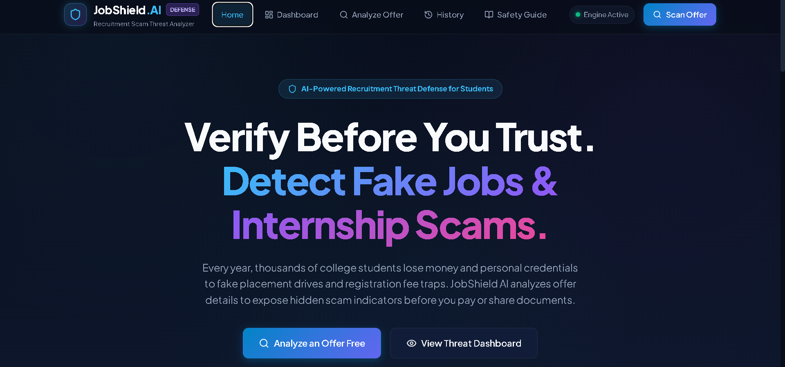
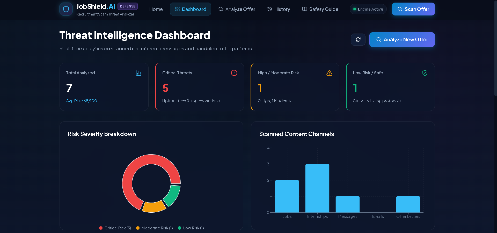
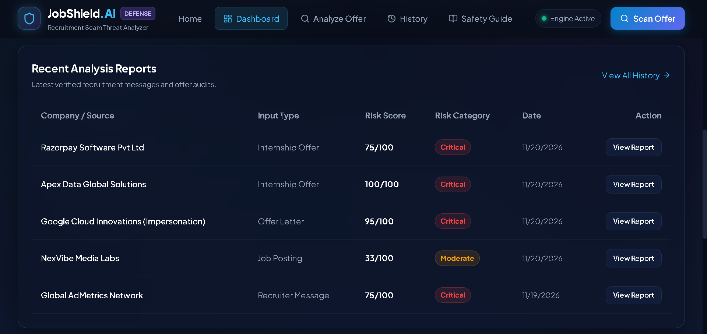
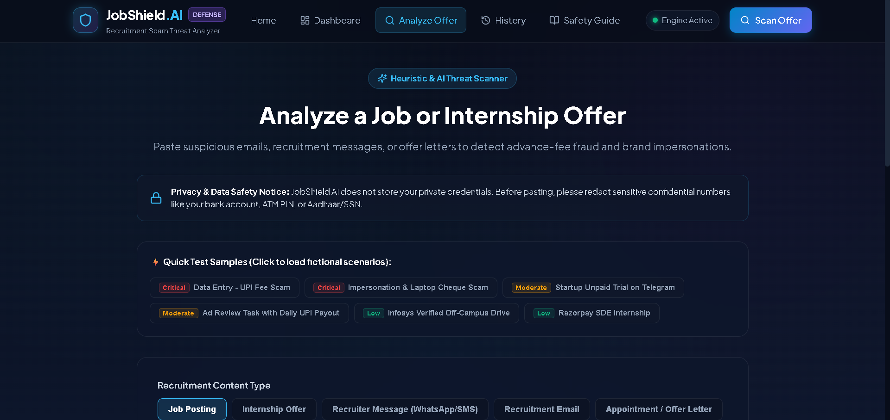
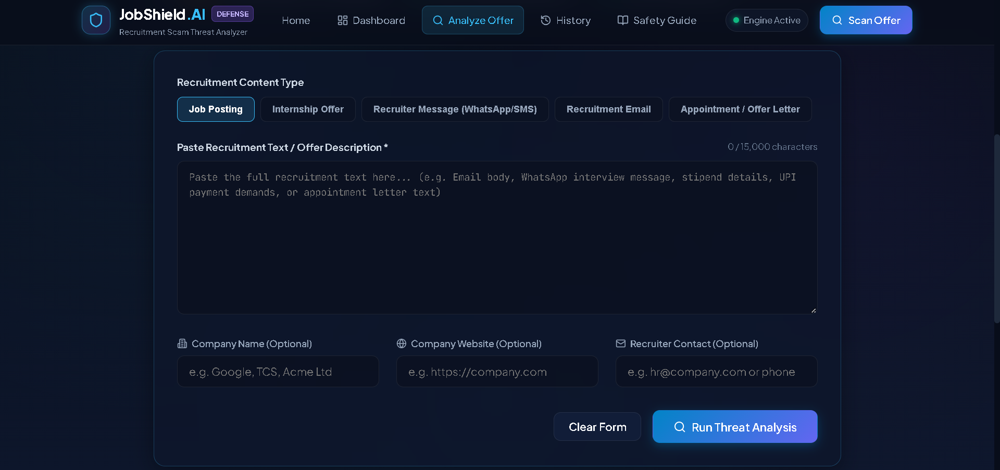
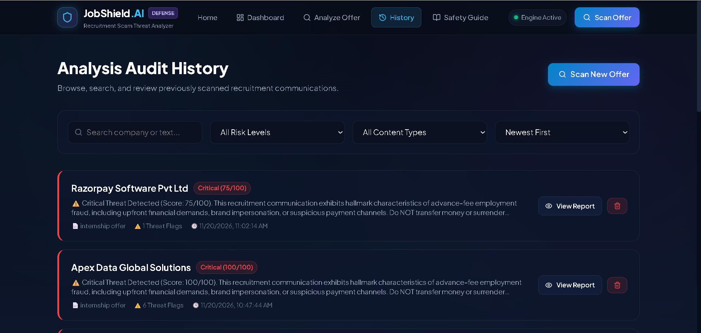
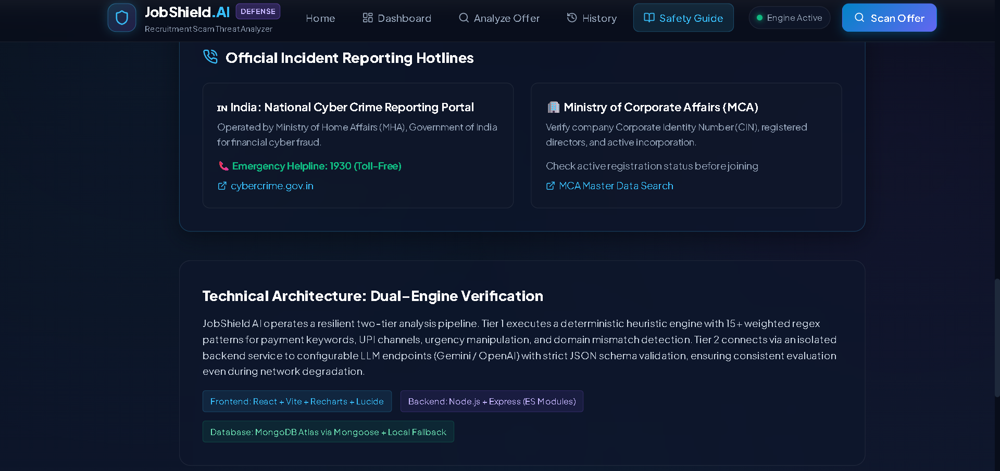
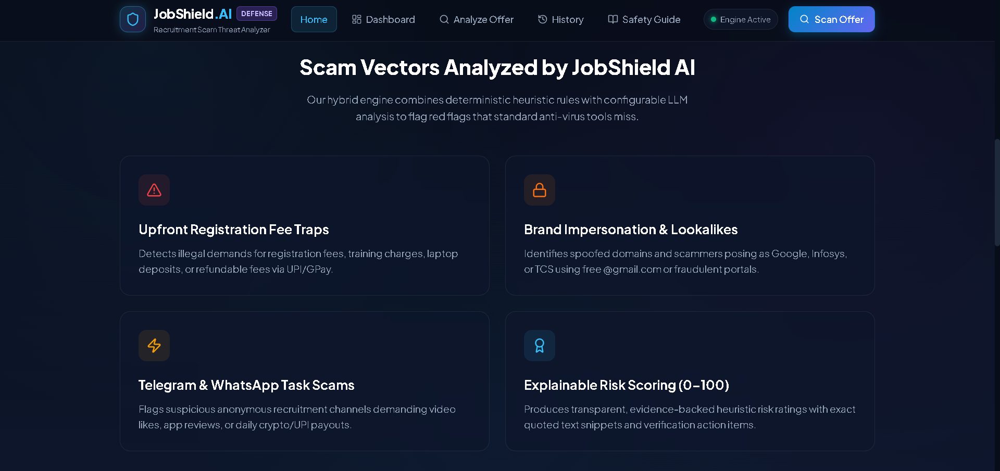
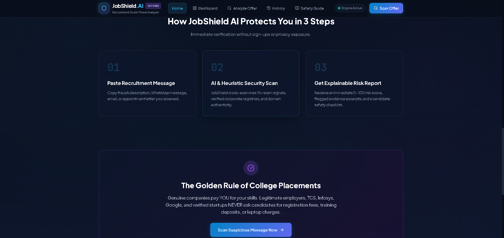

# 🛡️ JobShield AI
### AI-Powered Job & Internship Scam Detection Platform

**Protect your career. Detect suspicious job offers. Apply with confidence.**

JobShield AI is a cybersecurity-focused web application designed to help students and job seekers identify potential recruitment scams. It analyzes job descriptions, internship offers, recruiter messages, emails, and appointment letters to identify suspicious patterns and provide explainable risk assessments.

The platform combines a deterministic rule-based threat detection engine with optional Large Language Model (LLM) integration to identify red flags, assess company information, and recommend verification steps.

---

## 📸 Application Screenshots

The following screenshots showcase the JobShield AI interface. Click any image to view it in full size.

### 1. 🏠 Homepage
<a href="./Screenshots/01-homepage.webp.png"></a>

### 2. 📊 Threat Intelligence Dashboard
<a href="./Screenshots/02-threat-intelligence-dashboard.webp.png"></a>

### 3. 📈 Recent Analysis Reports
<a href="./Screenshots/03-recent-analysis-reports.webp.png"></a>

### 4. 🔍 Analyze Job or Internship Offer
<a href="./Screenshots/04-analyze-offer-page.webp.png"></a>

### 5. 📝 Recruitment Analysis Form
<a href="./Screenshots/05-recruitment-analysis-form.webp.png"></a>

### 6. 🗂️ Analysis History
<a href="./Screenshots/06-analysis-history.webp.png"></a>

### 7. 🛡️ Safety Guide
<a href="./Screenshots/07-safety-guide.webp.png">
  
</a>

### 8. 🏗️ Security Architecture and Reporting
<a href="./Screenshots/08-security-architecture-and-reporting.webp.png"></a>

### 9. 🚨 Scam Detection Features
<a href="./Screenshots/09-scam-detection-features.webp.png"></a>

### 10. ⚙️ How It Works
<a href="./Screenshots/10-how-it-works.webp.png"></a>

Note: Keep the image filenames and extensions exactly as shown above inside the repository's root-level screenshots/ folder. GitHub paths are case-sensitive.

## 🎯 Problem Statement

Students and fresh graduates are increasingly exposed to fraudulent job offers and internship scams, including:

- 💸 Fake registration fees and refundable security deposits.
- 🏢 Company impersonation and suspicious recruiter email addresses.
- 📱 Recruitment conducted exclusively through WhatsApp or Telegram.
- ⚠️ Unrealistic salary and stipend promises.
- 🔐 Requests for OTPs, bank PINs, or original educational documents.
- ⏳ High-pressure tactics designed to force immediate decisions.

JobShield AI aims to help candidates recognize these warning signs before sharing sensitive information or making payments.

---

## ✨ Key Features

### 🔍 1. Intelligent Job Offer Analysis
- Analyze job descriptions, internship offers, recruiter messages, emails, and offer letters.
- Detect suspicious recruitment patterns using configurable analysis logic.
- Generate a risk score from **0 to 100**.
- Display identified warning indicators with supporting evidence.
- Provide actionable recommendations for further verification.

### 🚨 2. Explainable Risk Assessment
Instead of displaying only a risk score, JobShield AI highlights the suspicious text and explains why it may be concerning.

| Risk Score | Risk Category | Suggested Response |
|---|---|---|
| 0–24 | 🟢 Low | Continue normal due diligence |
| 25–49 | 🟡 Moderate | Verify suspicious details carefully |
| 50–74 | 🟠 High | Investigate warning signs before proceeding |
| 75–100 | 🔴 Critical | Treat the offer with extreme caution |

*These categories are advisory assessments, not proof that an organization is fraudulent or legitimate.*

### 🏢 3. Company Verification
- Compare submitted company information against a curated directory of known enterprises.
- Identify potential company-name and domain mismatches.
- Highlight suspicious lookalike domains.
- Display official-source information when available.
- Provide safe manual verification steps.

**Important:** A directory match does not independently guarantee that a particular job offer is genuine.

### 📊 4. Analytics Dashboard
- View recruitment analysis statistics.
- Explore risk severity distributions.
- Review recruitment-content channel breakdowns.
- Visualize analysis metrics using charts.

### 📋 5. Analysis History
- Store previous analysis results.
- Search records using relevant keywords.
- Filter results by risk category and input type.
- Sort records by creation date or risk score.
- Open and delete individual analysis records.

### ✅ 6. Candidate Verification Checklist
Get practical verification steps to help investigate a suspicious offer before accepting it.

### 🧠 7. Hybrid Analysis Engine
- Deterministic rule-based detection engine.
- Optional Google Gemini or OpenAI integration.
- Automatic fallback to rule-based analysis when an LLM key is not configured or a network error occurs.
- Backend-managed AI configuration to prevent frontend exposure of API credentials.

### 💾 8. Flexible Data Persistence
- MongoDB integration using Mongoose when configured.
- Local JSON-based persistence fallback for development and demonstration.
- Run the project locally without mandatory MongoDB Atlas configuration.

### 🔐 9. Backend Security
- Security headers using Helmet.
- CORS configuration.
- API rate limiting.
- Request validation.
- Environment-based configuration for sensitive credentials.

---

## 🖥️ Technology Stack

### Frontend
- React.js
- Vite
- React Router
- Axios
- Recharts
- Lucide React
- CSS

### Backend
- Node.js
- Express.js
- JavaScript ES Modules
- REST API architecture

### Database & Storage
- MongoDB
- Mongoose
- Local JSON persistence fallback

### AI & Analysis
- Rule-based threat detection
- Optional Google Gemini integration
- Optional OpenAI integration
- Evidence-based risk indicators

### Development Tools
- Visual Studio Code
- npm
- Git
- GitHub

---

## 🏗️ System Architecture

```text
                  ┌──────────────────────────┐
                  │       USER / STUDENT     │
                  └────────────┬─────────────┘
                               │
                               ▼
                  ┌──────────────────────────┐
                  │     REACT FRONTEND        │
                  │                          │
                  │  Landing Page             │
                  │  Job Offer Analysis       │
                  │  Risk Results             │
                  │  Analytics Dashboard      │
                  │  Analysis History         │
                  └────────────┬─────────────┘
                               │
                         REST API / JSON
                               │
                               ▼
                  ┌──────────────────────────┐
                  │    NODE.JS + EXPRESS     │
                  │                          │
                  │  Input Validation        │
                  │  Security Middleware     │
                  │  API Rate Limiting       │
                  └────────────┬─────────────┘
                               │
                ┌──────────────┼──────────────┐
                ▼              ▼              ▼
       ┌────────────────┐ ┌─────────────┐ ┌────────────────┐
       │ Rule-Based     │ │ Company     │ │ Optional LLM   │
       │ Threat Engine  │ │ Verification│ │ Integration    │
       └────────┬───────┘ └──────┬──────┘ └───────┬────────┘
                └──────────────┬─┴────────────────┘
                               ▼
                  ┌──────────────────────────┐
                  │     STORAGE LAYER        │
                  │                          │
                  │ MongoDB / Local JSON     │
                  └────────────┬─────────────┘
                               ▼
                  ┌──────────────────────────┐
                  │  RISK RESULTS & GUIDANCE │
                  └──────────────────────────┘
```

---

## 📁 Project Structure

```text
JobShield-AI/
│
├── backend/
│   ├── data/
│   ├── src/
│   │   ├── config/
│   │   ├── controllers/
│   │   ├── middleware/
│   │   ├── routes/
│   │   ├── services/
│   │   ├── validators/
│   │   ├── app.js
│   │   └── server.js
│   ├── tests/
│   ├── .env.example
│   └── package.json
│
├── frontend/
│   ├── public/
│   ├── src/
│   │   ├── assets/
│   │   ├── components/
│   │   ├── pages/
│   │   ├── services/
│   │   ├── utils/
│   │   ├── App.jsx
│   │   └── main.jsx
│   ├── .env.example
│   └── package.json
│
├── docs/
│   ├── PROJECT_OVERVIEW.md
│   ├── API_DOCUMENTATION.md
│   ├── DATABASE_SCHEMA.md
│   ├── TESTING_GUIDE.md
│   └── VIVA_QUESTIONS.md
│
├── .gitignore
└── README.md
```

---

## ⚙️ Installation & Setup

### Prerequisites

Install the following before running the application:

- Node.js 18 or higher
- npm
- Git
- A code editor such as Visual Studio Code

MongoDB and an external AI API key are optional for local development.

### 1. Clone the Repository

```bash
git clone https://github.com/nishanttyagi8630/JobShield-AI.git
```

Navigate to the project directory:

```bash
cd JobShield-AI
```

### 2. Configure the Backend

Open a terminal:

```bash
cd backend
npm install
```

Create your local environment file in the backend directory.

**Windows PowerShell:**

```powershell
Copy-Item .env.example .env
```

Open `backend/.env` and configure the following variables as required:

```env
PORT=5000
NODE_ENV=development
MONGODB_URI=
FRONTEND_URL=http://localhost:5173

AI_PROVIDER=gemini
AI_API_KEY=
AI_MODEL=gemini-1.5-flash
```

**Configuration notes:**

- Leave `MONGODB_URI` empty to use the project's local persistence fallback.
- Configure a valid MongoDB connection string if you want to use MongoDB.
- Configure an appropriate provider and API key if you want to enable external LLM analysis.
- Keep API keys and database credentials private. Never commit your actual `.env` file.

Start the backend:

```bash
npm run dev
```

Alternatively, run:

```bash
npm start
```

The backend is configured to use:

`http://localhost:5000`

Check the health endpoint:

`http://localhost:5000/api/health`

### 3. Configure the Frontend

Open a second terminal from the project root:

```bash
cd frontend
npm install
```

Create the frontend environment file:

```powershell
Copy-Item .env.example .env
```

The default local configuration is:

```env
VITE_API_BASE_URL=http://localhost:5000/api
```

Start the frontend development server:

```bash
npm run dev
```

Open the local URL displayed in your terminal. The default Vite address is:

`http://localhost:5173`

### 4. Run the Complete Application

Keep both terminals running:

| Component | Command | Default Address |
|---|---|---|
| Backend | `npm run dev` inside `backend/` | `http://localhost:5000` |
| Frontend | `npm run dev` inside `frontend/` | `http://localhost:5173` |

The frontend communicates with the backend through the configured API base URL.

---

## 🔌 API Overview

The backend exposes REST API endpoints for threat analysis, company verification, history management, and analytics.

Base URL:

```text
http://localhost:5000/api
```

| Method | Endpoint | Purpose |
|---|---|---|
| GET | `/health` | Check backend status |
| POST | `/analyze` | Analyze a job or internship offer |
| POST | `/verify-company` | Check company information |
| GET | `/analyses` | Retrieve and filter analysis history |
| GET | `/analyses/:id` | Retrieve an individual analysis |
| DELETE | `/analyses/:id` | Delete an analysis record |
| GET | `/stats` | Retrieve dashboard statistics |

See [`docs/API_DOCUMENTATION.md`](docs/API_DOCUMENTATION.md) for endpoint details, request formats, and example responses.

---

## 🧪 Testing

JobShield AI includes automated backend unit and integration tests.

Run the backend test suite:

```bash
cd backend
npm test
```

The project documentation describes 18 tests covering the REST API, company verification service, and rule-based detection engine.

To create a production build of the frontend:

```bash
cd frontend
npm run build
```

A successful build verifies that Vite can compile the frontend application.

For more details, see [`docs/TESTING_GUIDE.md`](docs/TESTING_GUIDE.md).

---

## 📚 Project Documentation

The repository includes additional technical documentation:

- [Project Overview & Architecture](docs/PROJECT_OVERVIEW.md)
- [REST API Documentation](docs/API_DOCUMENTATION.md)
- [Database Schema](docs/DATABASE_SCHEMA.md)
- [Testing Guide](docs/TESTING_GUIDE.md)
- [Technical Viva Questions](docs/VIVA_QUESTIONS.md)

These documents explain the architecture, API behavior, data model, testing process, and project concepts.

---

## 🚀 Future Enhancements

Potential future improvements include:

- More extensive verified-company data sources.
- Additional detection rules for emerging recruitment scams.
- Expanded support for different recruitment document formats.
- Improved multilingual analysis for Indian job seekers.
- Additional explainability and evidence visualization.
- Deployment with production monitoring and secure cloud storage.
- More comprehensive automated testing.

These are potential enhancements and should not be interpreted as features already implemented.

---

## 🎓 Project Information

**Project Name:** JobShield AI  
**Project Type:** AI-Assisted Cybersecurity Web Application  
**Domain:** Artificial Intelligence, Web Development & Recruitment Scam Detection  
**Frontend:** React.js + Vite  
**Backend:** Node.js + Express.js  
**Storage:** MongoDB / Local JSON Persistence  

---

## ⚖️ Disclaimer

JobShield AI is an educational and informational tool intended to help users identify potentially suspicious recruitment communications.

Its risk scores and indicators are based on configured detection rules and, when enabled, optional AI analysis. Results may be incomplete or inaccurate.

A high score does not prove that a company is fraudulent, and a low score does not guarantee that an offer is genuine.

Always verify job opportunities independently through official company career portals and trusted sources. Never share OTPs, banking PINs, passwords, or make payments solely because a recruiter requests them.

---

## 👨‍💻 Author

**Nishant Tyagi**

GitHub: [@nishanttyagi8630](https://github.com/nishanttyagi8630)

Explore the repository, review the code, and contribute suggestions to improve recruitment scam awareness.

---

### ⭐ Support the Project

If you find JobShield AI useful, consider giving the repository a **star ⭐** on GitHub.

**Stay alert. Verify before you trust. Protect your career with JobShield AI.**
